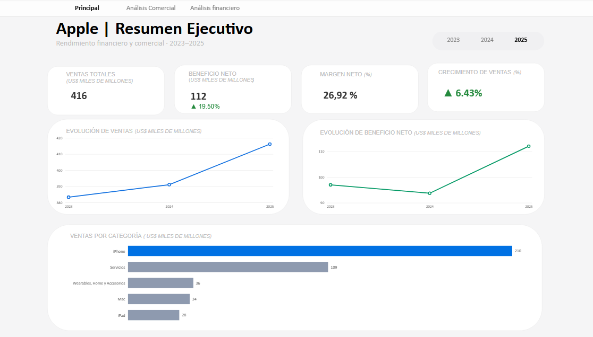
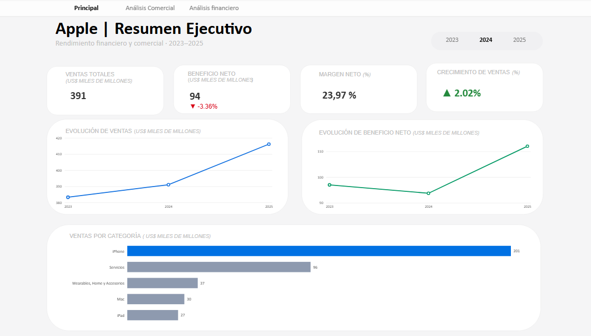
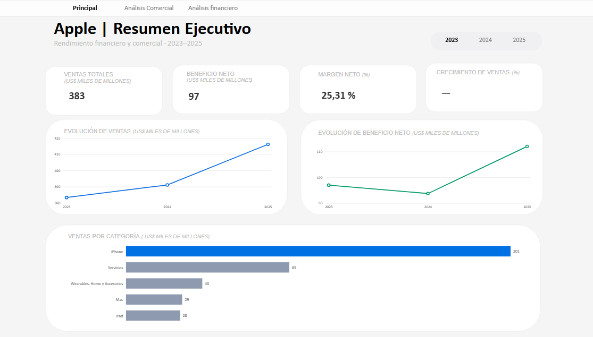
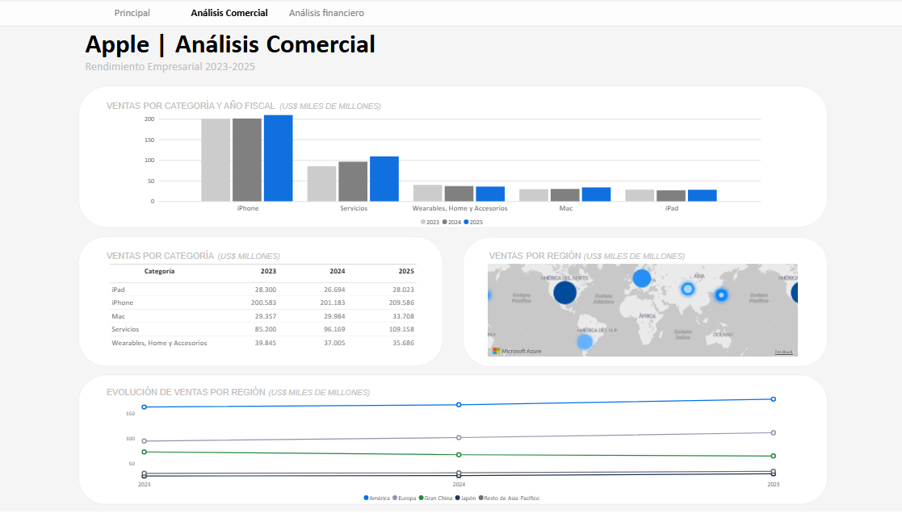
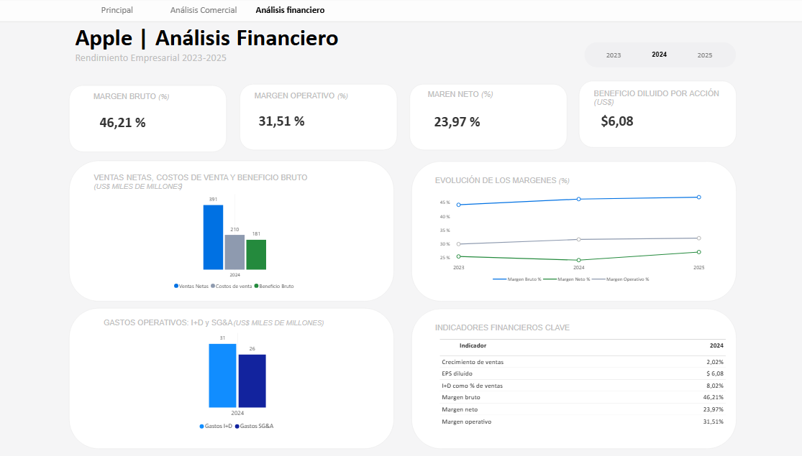
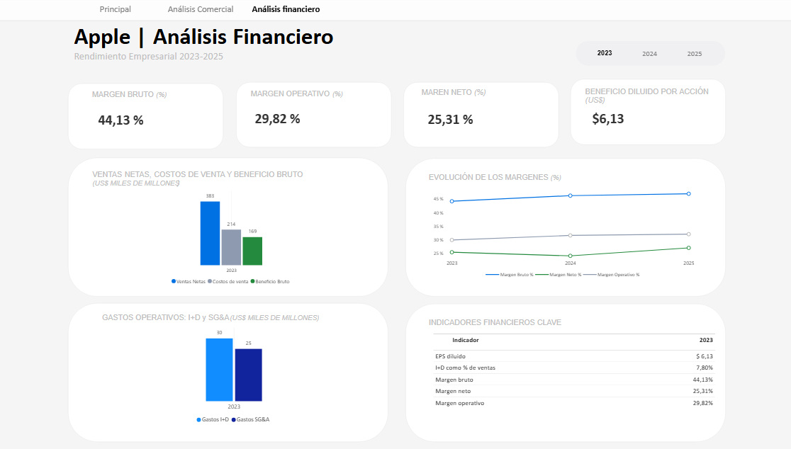

# Apple | Análisis Financiero y Comercial

Dashboard interactivo desarrollado en Power BI como parte de mi formación en análisis de datos. El proyecto analiza el desempeño financiero y comercial de Apple durante los años fiscales 2023, 2024 y 2025.

## Objetivo

Transformar datos financieros y comerciales en información visual que permita identificar tendencias, comparar resultados y evaluar el desempeño del negocio.

## 1. Resumen Ejecutivo

Vista general de los principales indicadores: ventas totales, beneficio neto, margen neto y crecimiento de ventas.

### Año fiscal 2025

### Año fiscal 2024

### Año fiscal 2023

## 2. Análisis Comercial

Comparación de las ventas por categoría de producto y región, con evolución entre años fiscales.

## 3. Análisis Financiero

Evaluación de márgenes bruto, operativo y neto, ventas, costos, beneficio bruto, gastos operativos e indicadores financieros.

### Año fiscal 2025

### Año fiscal 2024

### Año fiscal 2023

## Herramientas

- Power BI
- DAX
- Power Query

## Fuente de datos

Informes financieros públicos de Apple correspondientes al periodo analizado.

## Nota

Proyecto formativo elaborado con fines de aprendizaje y demostración de habilidades de análisis y visualización de datos.