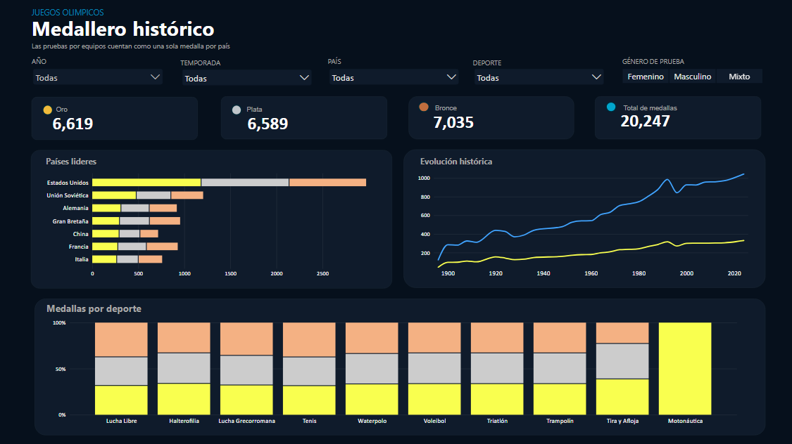
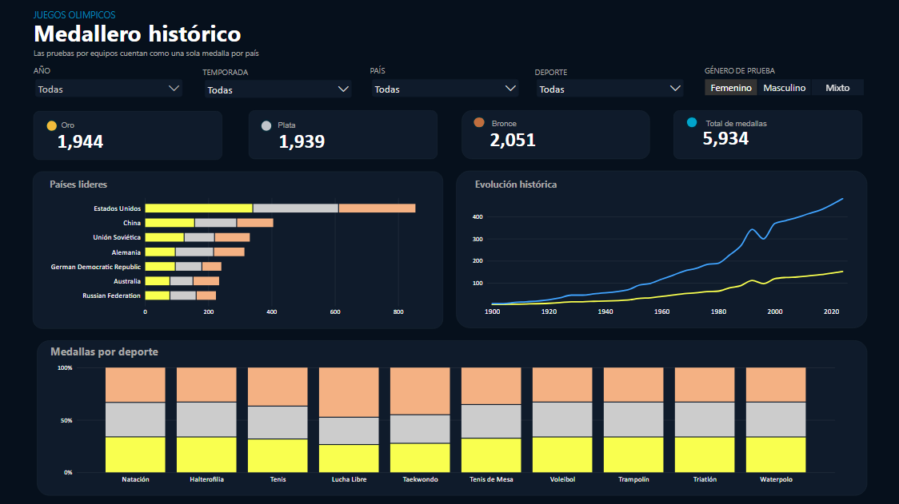
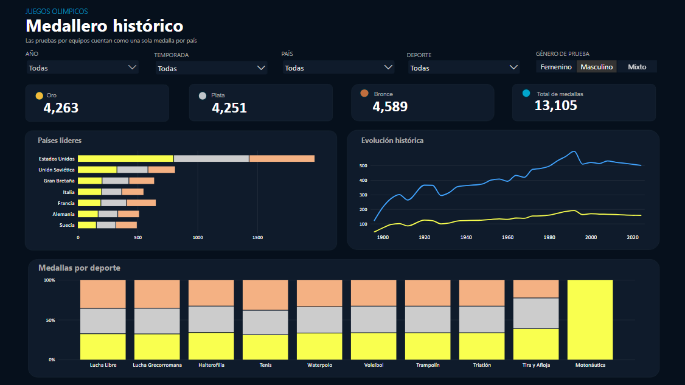

# Medallero Olímpico | Análisis Histórico con Power BI

## Descripción del proyecto

Desarrollado como parte de mi formación en análisis de datos. El proyecto explora el medallero histórico de los Juegos Olímpicos, desde las primeras ediciones hasta París 2024, utilizando un conjunto de datos de aproximadamente 20.000 registros.

## Objetivo

Transformar datos históricos del deporte olímpico en información visual que facilite la comparación entre países, el análisis de medallas por género y la identificación de patrones a lo largo de la historia de los Juegos Olímpicos.

## Vistas del dashboard

### 1. Medallero general

Análisis del medallero histórico para comparar el desempeño de los países participantes e identificar a las naciones con mayor número de medallas.

### 2. Medallero femenino

Exploración de los resultados olímpicos femeninos, con comparaciones entre países y disciplinas deportivas.

### 3. Medallero masculino

Análisis de las medallas obtenidas en las competiciones masculinas, destacando los resultados por país y disciplina.

## Principales hallazgos

- Estados Unidos encabeza el medallero general y destaca entre los países líderes al segmentar los resultados por género.
- China sobresale en el medallero femenino, mientras que la Unión Soviética figura entre los principales referentes del masculino.
- La lucha libre destaca en el medallero masculino y la natación sobresale en el femenino.
- El análisis también explora disciplinas menos habituales, como el triatlón, el trampolín, el tira y afloja y la motonáutica.

## Herramientas y habilidades aplicadas

- **Power BI:** diseño de visualizaciones e informes interactivos.
- **Power Query:** limpieza y transformación de datos.
- **DAX:** creación de medidas e indicadores.
- **Modelado de datos:** organización de la información para facilitar el análisis.
- **Visualización de datos:** comparación de resultados mediante gráficos, indicadores y filtros interactivos.

## Fuente de datos

*Olympic Medalist Dataset (1896–2024)*, publicado por `sainsdataid` en GitHub a partir de datos de OlympAnalyt. Se utilizó el archivo `all_olympic_medalists.csv`, que abarca los Juegos Olímpicos de verano e invierno.

## Aprendizajes

Este proyecto me permitió fortalecer mis habilidades en análisis de datos, preparación de información y Business Intelligence, explorando cómo una visualización adecuada puede facilitar la comprensión de grandes volúmenes de datos.

---

Proyecto formativo desarrollado con fines de aprendizaje y demostración de habilidades de análisis y visualización de datos.